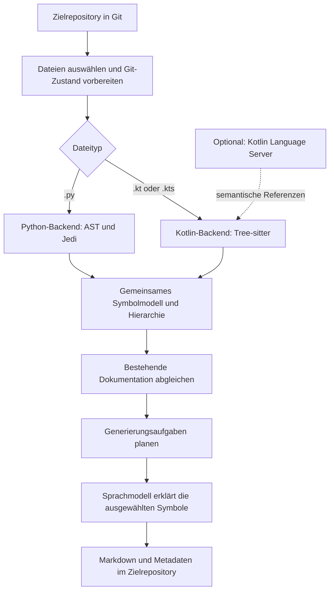
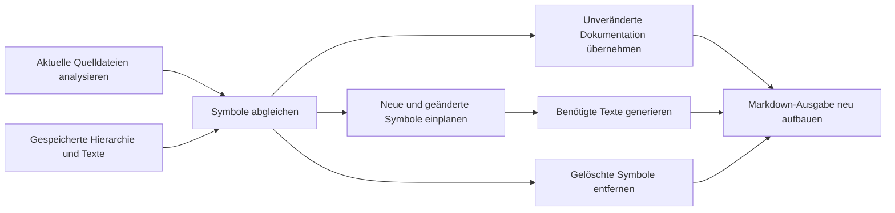

# RepoAgent verstehen

## Architektur, Dokumentationsablauf und Kotlin-Unterstützung

> **Die Grundidee:** RepoAgent liest ein Git-Repository, zerlegt den Quellcode in
> dokumentierbare Bausteine und lässt ein Sprachmodell diese Bausteine erklären.
> Python und Kotlin liefern dafür ein gemeinsames Datenformat. Anschließend
> verwenden beide dieselbe Verarbeitung bis zur fertigen Markdown-Dokumentation.

**Lesepfad:** [Gesamtbild](#1-das-gesamtbild) ·
[Python und Kotlin](#2-was-ist-gemeinsam-was-ist-sprachspezifisch) ·
[Kotlin-Beispiel](#4-ein-kotlin-beispiel-vom-code-zur-dokumentation) ·
[Referenzen mit LSP](#5-warum-kotlin-zwei-analysewerkzeuge-verwendet) ·
[Änderungen](#7-wie-aktualisierungen-funktionieren) ·
[Benutzung](#8-so-verwendest-du-den-fork)

---

## 1. Das Gesamtbild

Es gibt zwei getrennte Repositories: **Diesen RepoAgent-Fork**, in dem das
Dokumentationswerkzeug entwickelt wird, und **dein Zielrepository**, dessen Code
erklärt werden soll. Das Zielrepository kann in Kotlin geschrieben sein,
während RepoAgent selbst weiterhin eine Python-Anwendung bleibt.



Der Parser bestimmt, **welche Codebausteine existieren und wo sie stehen**.
Die Referenzanalyse ergänzt, **welche Bausteine andere verwenden**.
Das Sprachmodell formuliert daraus **lesbare Erklärungen**.

## 2. Was ist gemeinsam, was ist sprachspezifisch?

Die Erweiterung fügt ein Kotlin-Backend neben dem Python-Backend ein. Der
nachfolgende Dokumentationsprozess wird gemeinsam genutzt.

| Aufgabe | Python | Kotlin |
|---|---|---|
| Dateiauswahl | `.py` | `.kt` und `.kts` |
| Syntaxanalyse | Python-Modul `ast` | Tree-sitter mit gebündelter Kotlin-Grammatik |
| Referenzen | Jedi | Optionaler Kotlin Language Server über LSP |
| Dokumentierbare Elemente | Klassen, Funktionen, Methoden, asynchrone Funktionen | Zusätzlich Kotlin-Formen wie Interfaces, Objects, Properties und Typaliasse |
| Interne Repräsentation | Gemeinsame Symbolfelder und `DocItem`-Hierarchie | Dasselbe Grundmodell mit Kotlin-Zusatzfeldern |
| Textgenerierung | Gemeinsame LLM-Anbindung | Gemeinsame LLM-Anbindung |
| Ergebnis | Markdown, Hierarchie-JSON und Checkpoints | Dieselben Ausgabearten |

Das Backend erfüllt zwei Aufgaben:

```python
parse(source) -> list[dict]
references(repo_path, file_path, symbol, in_file_only=False)
```

`parse` liefert die Beschreibung der Deklarationen. `references` liefert
Fundstellen, an denen ein Symbol verwendet wird. Die Backend-Auswahl erfolgt
anhand der Dateiendung; `--source-language` begrenzt die zugelassenen Dateitypen.

## 3. Der Ablauf einer Dokumentationsgenerierung

### Schritt 1: Dateien auswählen

RepoAgent sucht im Zielrepository nach den ausgewählten Quelldateien. Dabei
berücksichtigt es seine Gitignore-Verarbeitung und die konfigurierte Ignore-Liste.
Typische Verwaltungs- und Build-Verzeichnisse wie `.git`, `.gradle`, `.kotlin`,
`.venv` und `build` werden ausgeschlossen.

Neu angelegte Quelldateien müssen mit `git add` vorgemerkt sein. Ungetrackte
Quelldateien werden übersprungen.

### Schritt 2: Den analysierten Git-Zustand festlegen

Wenn eine Datei sowohl vorgemerkte als auch weitere, ungestagte Änderungen hat,
analysiert RepoAgent den Stand aus dem **Git-Index**, also der Staging Area.
Dafür sichert es den Arbeitsstand vorübergehend und stellt ihn anschließend
wieder her. So passen die Dokumentationsgrundlage und die vorgemerkten Änderungen
zusammen.

### Schritt 3: Deklarationen extrahieren

Das passende Backend liest jede Quelldatei. Für ein Kotlin-Symbol erfasst es unter
anderem Name, Art, Signatur, Parameter, Receiver, Quelltextbereich, KDoc und das
übergeordnete Symbol. Die eigentliche Kotlin-Datei wird dabei nicht umgeschrieben.

### Schritt 4: Hierarchie und Referenzen aufbauen

Aus den Symbolen entsteht ein Baum aus Repository, Verzeichnissen, Dateien und
Deklarationen. Verfügbare Referenzen ergänzen Beziehungen zwischen den Symbolen.
Für Kotlin kommen diese Beziehungen vom optionalen Language Server.

### Schritt 5: Aufgaben planen und Texte erzeugen

Beim ersten Durchlauf werden die dokumentierbaren Symbole eingeplant. Bei
weiteren Durchläufen wird der neue Zustand mit gespeicherten Metadaten verglichen.

Die Aufgabenplanung berücksichtigt Referenzabhängigkeiten, damit Dokumentation
verwendeter Symbole möglichst schon als Kontext verfügbar ist. Unabhängige
Aufgaben können parallel laufen. Dafür werden Worker-Threads verwendet.

Das Sprachmodell erhält den Code des Symbols, seinen Kontext und gegebenenfalls
Code und Dokumentation referenzierter Symbole. Es erzeugt die Erklärung in der
gewählten Dokumentationssprache.

### Schritt 6: Ergebnisse speichern

RepoAgent speichert die generierten Texte und seinen Bearbeitungsstand. Der
Markdown-Renderer schreibt pro Quelldatei ein Dokument mit verschachtelten
Überschriften für deren Deklarationen. Bei Aktualisierungsläufen werden erzeugte
Dokumentations- und Metadatendateien außerdem zur Staging Area hinzugefügt.
Ein automatischer Git-Commit wird im aktuellen Ablauf nicht ausgeführt.

## 4. Ein Kotlin-Beispiel: vom Code zur Dokumentation

Angenommen, dein Zielrepository enthält diese Datei:

**`src/main/kotlin/demo/UserService.kt`**

```kotlin
package demo

data class User(val id: Int, val name: String)

interface UserRepository {
    suspend fun findById(id: Int): User?
}

/** Stellt den Zugriff auf Benutzer bereit. */
class UserService(private val repository: UserRepository) {
    suspend fun find(id: Int): User? = repository.findById(id)
}
```

### A. Das Backend erkennt die Struktur

```text
UserService.kt
├── User                         Klasse
│   ├── id                       Constructor-Property
│   └── name                     Constructor-Property
├── UserRepository               Interface
│   └── findById(Int)            suspend-Funktion
└── UserService                  Klasse mit KDoc
    ├── repository               Constructor-Property
    └── find(Int)                suspend-Funktion
```

`User?` und `suspend` bleiben im Originalcode erhalten und stehen dem Sprachmodell
zur Verfügung. Das Backend führt die Funktion nicht aus und prüft nicht selbst
die Kotlin-Typkorrektheit.

### B. Daraus entstehen gemeinsame Symboldaten

Ein gekürzter Ausschnitt für `find` sieht so aus:

```json
{
  "type": "FunctionDef",
  "name": "find",
  "language": "kotlin",
  "kind": "Function",
  "signature": "find(Int)",
  "symbol_id": "UserService/find(Int)",
  "parent_id": "UserService",
  "params": ["id"],
  "parameter_types": ["Int"],
  "code_content": "suspend fun find(id: Int): User? = repository.findById(id)",
  "md_content": []
}
```

`FunctionDef` ist hier die gemeinsame Kategorie für die Verarbeitung. Der
Quellcode und `language: kotlin` geben den sprachspezifischen Kontext an.

### C. Optional kommen Referenzen hinzu

Mit einem passend eingerichteten und erfolgreich indexierenden Kotlin Language
Server kann RepoAgent die Verwendung von `findById` durch `find` übernehmen.
Diese Beziehung wird in beide Richtungen gespeichert:

| Feld | Bedeutung im Beispiel |
|---|---|
| `find.reference_who` | Welche dokumentierten Symbole verwendet `find`? |
| `findById.who_reference_me` | Welche dokumentierten Symbole verwenden `findById`? |

Das ist ein Referenzgraph. Er ist keine Aufzeichnung tatsächlich ausgeführter
Programmaufrufe; die Auflösung hängt von der Analyse des Language Servers ab.

### D. Das Sprachmodell formuliert die Erklärung

Der Prompt enthält den Quelltext, den Symbolpfad, die Quellsprache, die gewünschte
Textsprache und die verfügbaren Referenzen. Bestehendes KDoc wird beim zugehörigen
Symbol als Teil des Codekontexts berücksichtigt.

Ein **illustrativer**, nicht hier generierter Markdown-Ausschnitt wäre:

```markdown
## Class UserService(repository)

**UserService**: Stellt einen Zugriff auf Benutzer über ein UserRepository bereit.

### Function find(Int)

**find**: Sucht einen Benutzer anhand seiner ID.

**parameters**:
· id: ID des gesuchten Benutzers.

**Code Description**: Delegiert die Suche an repository.findById.
Das Ergebnis kann null sein. Die suspend-Funktion wird aus einem geeigneten
Coroutine-Kontext aufgerufen.
```

Die konkrete Formulierung stammt vom konfigurierten Sprachmodell und kann variieren.
Die Reihenfolge und Verschachtelung der Überschriften kommen vom Renderer.

## 5. Warum Kotlin zwei Analysewerkzeuge verwendet

### Tree-sitter: Struktur erkennen

Tree-sitter beantwortet Fragen wie: Wo beginnt eine Klasse? Welche Parameter hat
eine Funktion? Zu welchem Objekt gehört eine Methode?

Verwendet wird die Kotlin-Grammatik aus
`tree-sitter-language-pack==0.13.0`. Sie ist gebündelt und muss während einer
Dokumentationsgenerierung nicht aus dem Internet nachgeladen werden.

### Kotlin LSP: Bedeutungen und Referenzen auflösen

Gleichnamige Funktionen, Imports, Receiver und Typen machen Kotlin-Referenzen
komplexer als eine Textsuche. Ein Language Server kann Projekt- und Typinformationen
verwenden, um Fundstellen einem konkreten Symbol zuzuordnen.

**LSP** steht für *Language Server Protocol*. RepoAgent startet einen separat
installierten Server und kommuniziert mit ihm über standardisierte Nachrichten
auf dessen Standardein- und -ausgabe. Dabei öffnet es die Kotlin-Dateien im
Server und fragt Referenzen über `textDocument/references` ab.

| Betriebsart | Verfügbare Grundlage |
|---|---|
| Kotlin ohne LSP | Deklarationen, Hierarchie, Signaturen, Quelltext und KDoc |
| Kotlin mit LSP | Zusätzlich die vom Server gelieferten semantischen Referenzen |

Ohne LSP wird die Dokumentation trotzdem erzeugt. Fehlende Beziehungen werden
nicht durch bloßes Namensmatching ergänzt. Ist ein LSP-Server ausdrücklich
konfiguriert, werden Start-, Protokoll- und Timeoutfehler sichtbar weitergegeben.

## 6. Kotlin-Besonderheiten im gemeinsamen Modell

| Kotlin-Konstrukt | Verarbeitung |
|---|---|
| `class`, `data class`, Enum-Klasse | Als Klasse; Deklaration und Modifikatoren bleiben im Quelltext |
| `interface` | Gemeinsamer Typ `ClassDef`, genauere Art `Interface` |
| `object`, `companion object` | Eigene Container mit ihren untergeordneten Symbolen |
| Top-Level- und Member-Funktionen | Eigene Funktionssymbole |
| Extension Functions | Receiver wird erfasst und in die Signatur aufgenommen |
| `suspend` und nullable Typen | Bleiben im Quelltext für die Dokumentation erhalten |
| `val` und `var` | Eigene Property-Symbole, auch im primären Konstruktor |
| Sekundäre Konstruktoren | Eigene Konstruktorsymbole mit Parametern |
| `typealias` | Eigenes Symbol vom Typ `TypeAliasDef` |
| Lokale Variablen | Keine eigenen Dokumentationsabschnitte |
| `.kts`-Skripte | Deklarationen werden erfasst; freie Skriptanweisungen erhalten keine eigenen Abschnitte |

### Überladungen behalten ihre Zuordnung

```kotlin
fun parse(value: Int) = value.toString()
fun parse(value: String) = value.trim()
```

Hier entstehen die Identitäten `parse(Int)` und `parse(String)`. Werden die
Funktionen vertauscht, bleibt ihre bisherige Dokumentation dem jeweiligen Symbol
zugeordnet. Receiver, generische Parameter und Parametertypen gehen ebenfalls in
die syntaktische Identität ein. Diese Identität ersetzt keine compilerseitige
Auflösung vollständig qualifizierter Typen.

## 7. Wie Aktualisierungen funktionieren

RepoAgent speichert seine Metadaten, damit es vorhandene Dokumentation beim
nächsten Lauf wiederverwenden kann.



| Änderung | Verhalten |
|---|---|
| Neues Symbol | Bekommt eine Generierungsaufgabe |
| Quelltext eines Symbols verändert | Dokumentation wird zur Aktualisierung markiert |
| Symbol unverändert | Vorhandener Text wird übernommen |
| Symbol oder Datei gelöscht | Entfällt in der neu aufgebauten Markdown-Ausgabe |
| Liste referenzierender Symbole verändert | Kann eine Aktualisierung auslösen; für Kotlin ist dafür LSP nötig |
| Reihenfolge von Kotlin-Überladungen verändert | Die Signaturen erhalten die Zuordnung zu bisherigen Texten |

Der Vergleich verwendet die gespeicherten Symbolinformationen und Quelltexte.
Er ist keine vollständige transitive Auswirkungsanalyse. Eine Änderung einer
aufgerufenen Funktion führt daher nicht automatisch dazu, dass alle ihre
indirekten Aufrufer neu dokumentiert werden.

## 8. So verwendest du den Fork

### Einmalige Installation aus diesem Checkout

```sh
python -m pip install -e '.[kotlin]'
```

Der Zusatz `[kotlin]` installiert die optionalen Parserabhängigkeiten.
Für ein reines Python-Setup reicht `pip install -e .`.

Die bestehende Konfiguration des Sprachmodell-Anbieters muss eingerichtet sein.
Das Zielrepository benötigt Git und einen ersten Commit.

### Kotlin dokumentieren

Neue oder geänderte Quelldateien zunächst im **Zielrepository** vormerken:

```sh
git add src/main/kotlin/demo/UserService.kt
```

Anschließend RepoAgent auf dieses Repository richten:

```sh
repoagent run \
  --target-repo-path /pfad/zum/kotlin-repo \
  --source-language kotlin \
  --language German
```

Für semantische Referenzen zusätzlich einen Kotlin Language Server installieren
und seinen stdio-Aufruf angeben:

```sh
repoagent run \
  --target-repo-path /pfad/zum/kotlin-repo \
  --source-language kotlin \
  --language German \
  --kotlin-lsp-command 'kotlin-lsp --stdio' \
  --kotlin-lsp-timeout 180
```

| Einstellung | Bedeutung |
|---|---|
| `--source-language auto` | Standard: Python und Kotlin verarbeiten |
| `--source-language kotlin` | Nur `.kt` und `.kts` verarbeiten |
| `--source-language python` | Nur `.py` verarbeiten |
| `--language German` | Deutsche Erklärungstexte erzeugen |
| `--ignore-list generated,vendor` | Genannte Dateien oder Verzeichnisse ausschließen |
| `--kotlin-lsp-command` | Optionaler Server für Kotlin-Referenzen |
| `--kotlin-lsp-timeout` | Wartezeit pro LSP-Anfrage in Sekunden |

## 9. Welche Dateien entstehen?

Beispielhafte Ausgabe **im Zielrepository**:

```text
mein-kotlin-repo/
├── src/main/kotlin/demo/UserService.kt
├── markdown_docs/
│   └── src/main/kotlin/demo/UserService.md
└── .project_doc_record/
    ├── project_hierarchy.json
    └── meta-info.json
```

| Ergebnis | Zweck |
|---|---|
| `markdown_docs/` | Lesbare Dokumentation mit einem Dokument pro Quelldatei |
| `project_hierarchy.json` | Symbole, Codebereiche, Dokumentation, Status und Referenzinformationen |
| `meta-info.json` | Repository-Version und Zustand der Dokumentationsgenerierung |

Ein Skript `build.gradle.kts` wird zu `build.gradle.kts.md`. Enthält ein gemischtes
Repository im selben Verzeichnis `App.py` und `App.kt`, entstehen `App.md` und
`App.kt.md`, damit beide Dokumente erhalten bleiben.

Der Markdown-Ordner wird bei einer Aktualisierung neu aufgebaut. Eigene,
manuell gepflegte Dokumente sollten deshalb außerhalb dieses Ausgabeordners liegen.

## 10. Orientierung im Quellcode

| Datei | Verantwortung |
|---|---|
| [`main.py`](../repo_agent/main.py) | CLI-Optionen und Start der Verarbeitung |
| [`settings.py`](../repo_agent/settings.py) | Konfiguration, Quellsprache und LSP-Optionen |
| [`backends/__init__.py`](../repo_agent/backends/__init__.py) | Backend-Auswahl und Zuordnung der Ausgabepfade |
| [`backends/base.py`](../repo_agent/backends/base.py) | Gemeinsamer Backend-Vertrag |
| [`backends/python.py`](../repo_agent/backends/python.py) | Python-AST und Jedi |
| [`backends/kotlin.py`](../repo_agent/backends/kotlin.py) | Kotlin-Deklarationen, Signaturen, KDoc und Quelltextpositionen |
| [`backends/lsp.py`](../repo_agent/backends/lsp.py) | Kommunikation mit dem Kotlin Language Server |
| [`file_handler.py`](../repo_agent/file_handler.py) | Quelldateien lesen und die Backend-Analyse anstoßen |
| [`doc_meta_info.py`](../repo_agent/doc_meta_info.py) | Hierarchie, Referenzgraph, Checkpoints und Zustandsabgleich |
| [`runner.py`](../repo_agent/runner.py) | Gesamtprozess und Markdown-Ausgabe |
| [`multi_task_dispatch.py`](../repo_agent/multi_task_dispatch.py) | Aufgabenabhängigkeiten und Worker-Threads |
| [`chat_engine.py`](../repo_agent/chat_engine.py) und [`prompt.py`](../repo_agent/prompt.py) | LLM-Kontext und Dokumentationstexte |
| [`utils/meta_info_utils.py`](../repo_agent/utils/meta_info_utils.py) | Git-Zwischenstände sichern und Arbeitsdateien wiederherstellen |

## 11. Stand der Umsetzung und Grenzen

**Implementiert und geprüft:** Python- und Kotlin-Analyse, gemeinsame Ausgabe,
stabile Kotlin-Überladungen, Referenzgraph über eine LSP-Anbindung, Metadaten-
Roundtrips, inkrementelle Änderungen, gelöschte Quelldateien und Wiederherstellung
ungestagter Arbeitsstände. Beim Abschluss der Implementierung bestanden **32
Tests**. Pipeline-Tests verwenden ein simuliertes LLM; LSP-Tests einen lokalen
Protokoll-Testserver.

**Noch am konkreten Projekt zu verifizieren:** Die Integration mit einem echten
JetBrains Kotlin Language Server und dessen Import deines Kotlin-/Gradle-Projekts.
Android-, Multiplatform- und Compiler-Versionsunterstützung hängen vom Server ab.

Die gebündelte Syntaxgrammatik kann neuere Kotlin-Sprachformen ablehnen. Erkannte
Parsefehler brechen die Analyse sichtbar ab. Für bestimmte einzeilige
Blockabschlüsse besitzt das Backend einen Parser-Workaround mit Rückabbildung auf
die Originalpositionen; die Quelldatei bleibt unverändert.

Die erzeugten Texte erklären Codebausteine. Automatische fachliche Vollständigkeit,
ein Architekturhandbuch für das gesamte Produkt und eine vollständige README
werden dadurch nicht garantiert. Die Qualität der Texte hängt auch vom
konfigurierten Sprachmodell und dem verfügbaren Kontext ab.

## Weiterführende Dokumentation

- [Technische Einrichtung und Details des Kotlin-Backends](KOTLIN_BACKEND.md)
- [Projekt-README](../README.md)
- [Offizieller Kotlin Language Server](https://github.com/Kotlin/kotlin-lsp)
- [Gebündelte Parser-Version](https://pypi.org/project/tree-sitter-language-pack/0.13.0/)
